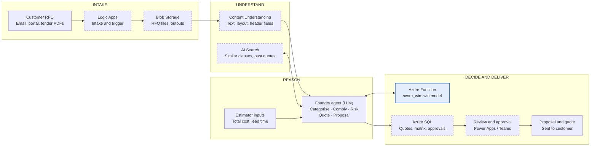

# Agent X: ETO Quote Intelligence

**AI on Microsoft Azure that reads customer RFQs, drafts compliance and commercial positions, predicts the chance of winning at each price, and assembles the quote and proposal for engineer approval.**

Built for engineer-to-order (ETO) businesses, where every quote needs custom engineering and most of that effort goes into bids that are lost.

---

## The problem

Before an ETO company can give a price, its engineers read 50–150 page tender packages, decide what they comply with, estimate cost without a final design, review risky contract terms and write the proposal. That work is slow, depends on a few senior people, and pricing is set by feel.

| Pain point | What happens today |
| --- | --- |
| Reading RFQs takes days | Tender packages are read line by line to build the requirement list and compliance matrix. |
| Effort spent on lost bids | Each quote takes tens of engineering hours, yet most bids are lost or cancelled. |
| Commercial risk slips through | Harsh liquidated damages, long warranties, unlimited liability and firm-price clauses are missed or not priced in. |
| Price set by intuition | No view of how win probability moves with price or lead time. |
| Knowledge sits with a few people | Which past job is similar, and how a clause was answered before, lives in senior engineers' memory. |
| Proposals assembled by hand | Content is copied from older proposals, with errors and inconsistent terms. |

**Baseline (synthetic sample of 6,000 RFQs):** ~63 hours per quote · 3 in 10 decided bids won · 10–27 numbered requirement clauses per RFQ.

> These figures come from the project's synthetic dataset, built to reflect typical ETO patterns. Replace them with measured values from your own CRM and ERP before using them in a business case.

---

## The solution

An RFQ assistant built in **Microsoft Foundry** reads the customer's documents, does the drafting, and calls a machine-learning service for the pricing decision. **Engineers and sales approve at each decision point; nothing is sent to a customer without approval.**

### Release 1 scope

| Use case | What it delivers | Type |
| --- | --- | --- |
| Requirement extraction and categorisation | Header fields and a categorised list of every requirement clause, with page references | Document AI + LLM |
| Compliance and deviation drafting | Comply, clarification or deviation for each clause, with draft wording | LLM + retrieval |
| Contract clause risk review | Risk level for each commercial clause against our standard position, with a counter-position | LLM + playbook |
| Win-probability prediction | Chance of winning at each candidate price and the price with the best expected margin | Machine learning |
| Automatic quote drafting | Draft cost basis and quote lines from the most similar past quotes | Retrieval + rules |
| Proposal writing | Technical and commercial proposal and quote document from our template | LLM |

Out of scope for now: cost-estimation models, lead-time prediction and ERP integration.

### Workflow

```mermaid
flowchart LR
    S1["1. RFQ arrives<br/><i>Logic Apps</i>"] --> S2["2. Read and extract<br/><i>Content Understanding</i>"]
    S2 --> S3["3. Categorise requirements<br/><i>Foundry agent</i>"]
    S3 --> S4["4. Draft compliance<br/>and deviations<br/><i>Agent + AI Search</i>"]
    S4 --> S5["5. Review contract risk<br/><i>Agent + playbook</i>"]
    S5 --> S6["6. Draft the quote<br/><i>Agent + AI Search</i>"]
    EST(["Estimator confirms<br/>cost and lead time"]) --> S6
    S6 --> S7["7. Predict win probability<br/><i>Azure Function</i>"]
    S7 --> S8["8. Write the proposal<br/><i>Foundry agent</i>"]
    S8 --> AP(["Engineering and<br/>sales approve"])
    AP -- changes --> S8
    AP -- approved --> OUT["Proposal and quote<br/>sent to customer"]

    classDef human fill:#e3edfb,stroke:#2f6fd6,stroke-width:2px;
    class EST,AP human;
```



| Step | Component | What happens |
| --- | --- | --- |
| 1. RFQ arrives | Logic Apps | Email or SharePoint attachments are saved to Blob Storage and processing starts. |
| 2. Read and extract | Content Understanding | PDFs become structured text; header fields are pulled out: customer, enquiry number, due date, delivery, LD %, warranty, payment terms, design code. |
| 3. Categorise requirements | Foundry agent | Each numbered clause is tagged: performance, design code, material, electrical, testing, documentation, commercial, site. |
| 4. Draft compliance and deviations | Foundry agent + AI Search | Similar clauses and past answers are retrieved; the agent drafts the response and wording for each clause. |
| 5. Review contract risk | Foundry agent + playbook | Commercial clauses are compared with standard positions and given a risk level and counter-position. |
| 6. Draft the quote | Foundry agent + AI Search | The most similar past quotes give a starting cost basis and quote lines. The estimator confirms total cost and lead time. |
| 7. Predict win probability | Azure Function (`score_win`) | The model scores a range of prices and recommends the one with the highest expected margin, inside the range it was trained on. |
| 8. Write the proposal and approve | Foundry agent → reviewer | The proposal, compliance matrix and quote are drafted from the template; engineering and sales review, edit and approve. |

---

## Architecture

Seven core Azure resources: Logic Apps, Blob Storage, Content Understanding, AI Search, a Foundry agent, an Azure Function and Azure SQL. Azure Machine Learning is not used: the win-probability model is a small tabular model, trained in Python and served from an Azure Function.



### Build status

| Component | Role | Status |
| --- | --- | --- |
| Azure Function (`score_win`) | Serves the win-probability model | ✅ Built and deployed (sandbox) |
| Foundry agent (LLM) | Categorise, comply, risk review, quote, proposal | Configured |
| Estimator inputs | Total cost and lead time | Input |
| Customer RFQ / Proposal and quote | Pipeline input and output | Input / output |
| Logic Apps | Intake and trigger | Planned |
| Blob Storage | RFQ files and outputs | Planned |
| Content Understanding | Text, layout, RFQ header fields | Planned |
| AI Search | Similar clauses and past quotes | Planned |
| Azure SQL | Quotes, matrix, approvals | Planned |
| Review and approval | Power Apps / Teams | Planned |

---

## Repository structure

```
.
├── README.md                  ← this file
└── score_win/                 ← win-probability Azure Function (Python)
    ├── function_app.py        ← POST /api/score_win, GET /api/health
    ├── train_model.py         ← trains the model (synthetic or CSV)
    ├── requirements.txt
    ├── host.json
    ├── local.settings.json
    ├── sample_request.json
    ├── .vscode/               ← VS Code Azure Functions settings
    └── README.md              ← detailed setup and deploy guide
```

---

## Win-probability model (`score_win`)

A gradient-boosted classifier (scikit-learn `HistGradientBoostingClassifier`) trained on decided bids. Win probability is constrained to **fall as price, lead time or deviations rise**, so the price search always behaves sensibly.

| Input | Meaning |
| --- | --- |
| `total_cost` | Estimator-confirmed total cost |
| `lead_time_weeks` | Promised delivery lead time |
| `ld_percent` | Liquidated damages cap, % of contract value |
| `warranty_months` | Warranty period offered |
| `clause_count` | Numbered requirement clauses in the RFQ |
| `deviations` | Deviations or clarifications we take |
| `repeat_customer` | 1 if we have won work from this customer before |
| `competitors` | Known or estimated number of bidders |

For each candidate price the function returns the win probability and the expected margin, **P(win) × (price − total cost)**, and recommends the best price **inside the markup range the model was trained on**. Inputs outside the training data come back as warnings.

**Sample model metrics (synthetic data):** test AUC 0.805 · win rate 28.6% · 6,000 RFQs.

### Quick start

```bash
cd score_win
python3.11 -m venv .venv && source .venv/bin/activate
pip install -r requirements.txt
python train_model.py            # or: python train_model.py --csv bids.csv
func start                       # or press F5 in VS Code
```

```bash
curl -X POST http://localhost:7071/api/score_win \
  -H "Content-Type: application/json" -d @sample_request.json
```

```json
{
  "recommended": {
    "price": 1475000.0,
    "markup": 1.18,
    "win_probability": 0.6978,
    "expected_margin": 157007.97,
    "in_training_range": true
  },
  "curve": [ "...one entry per candidate price..." ],
  "warnings": [],
  "note": "Recommendation only. Engineering and sales approve the final price."
}
```

Deployment from VS Code and connecting the function to the Foundry agent as an OpenAPI tool are covered in [`score_win/README.md`](score_win/README.md).

---

## Responsible AI and human review

- **Human approval at every decision point.** Engineering and sales approve compliance, risk positions, price and the proposal. Nothing reaches a customer without approval.
- **The estimator owns the numbers.** Retrieved past quotes are only a starting point; the estimator confirms total cost and lead time.
- **Bounded price recommendations.** The win model only recommends prices inside the range it was trained on, and flags out-of-range inputs.
- **Traceable outputs.** Requirements carry page references back to the RFQ; quotes, compliance matrices and approvals are stored in Azure SQL.
- **Honest data.** Baseline figures and model training use a synthetic dataset of 6,000 RFQs, to be replaced with real CRM and ERP data.

---

## Tech stack

Microsoft Foundry · Azure Functions (Python 3.11) · Azure AI Content Understanding · Azure AI Search · Azure Logic Apps · Azure Blob Storage · Azure SQL · Power Apps / Teams · scikit-learn
